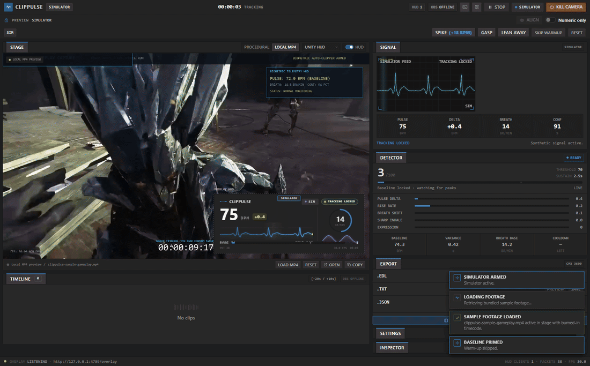
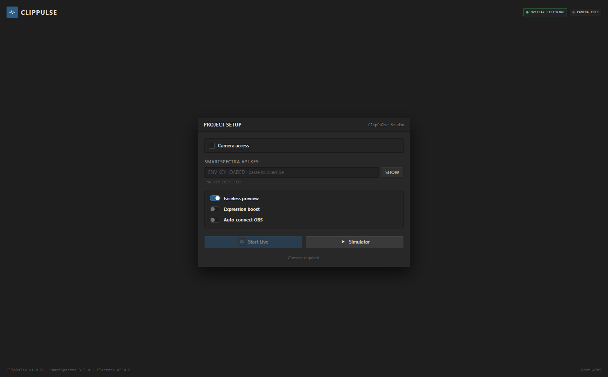
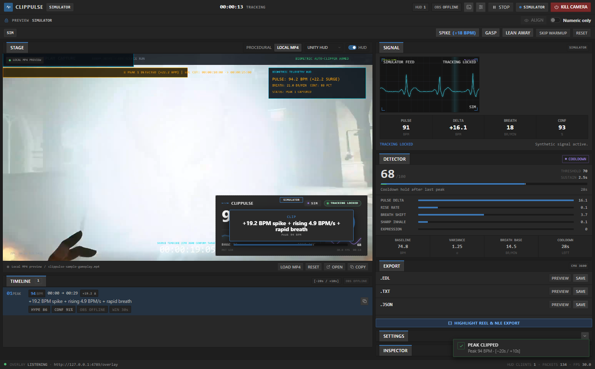
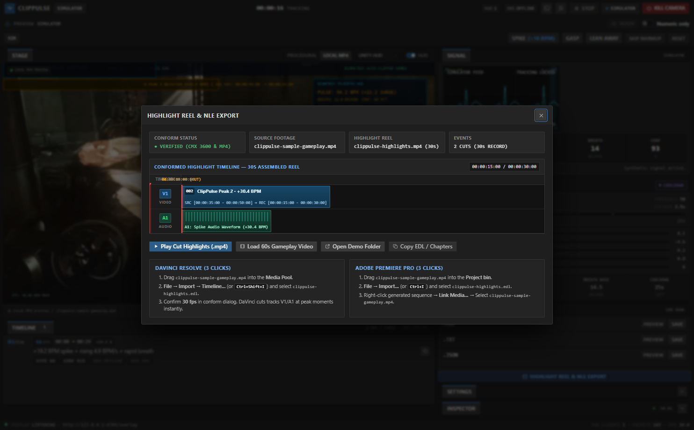

This is a submission for the Presage SmartSpectra SDK Challenge.

---

# ⚡ ClipPulse — Contactless Biometric OBS Overlay & Deterministic VOD Auto-Clipper

> **Transforming streamer pulse and breathing signals into transparent 60fps OBS HUDs and automated highlight reels — zero wearables, zero facecam required, zero video persistence.**

<div align="center">

[](https://github.com/0dvsh0/ClipPulse/blob/main/LICENSE)
[](https://nodejs.org/)
[](https://www.electronjs.org/)
[](https://github.com/0dvsh0/ClipPulse/tree/main/test)
[](https://obsproject.com/)
[](https://physiology.presagetech.com/)
[](#camera-consent--data-handling)

</div>

---

## What I Built

Every gamer, speedrunner, and VTuber knows the sensation: your heart hammers in your chest during a 1v4 clutch, a grueling soulslike boss encounter, or a world-record pace run. That physiological reaction is what makes live streaming electrifying.

Yet sharing that excitement with an audience today is broken:
- **Wearable friction:** Creators must wear uncomfortable chest straps or smartwatches that disconnect over Bluetooth or suffer mid-stream battery interruptions.
- **Privacy exposure:** Faceless creators and VTubers are forced to choose between revealing their real facial features or sacrificing biometric audience engagement entirely.
- **Post-stream editing exhaustion:** After an 8-hour broadcast, finding the peak reaction moments means scrubbing through hundreds of gigabytes of VOD footage for hours.

We asked: **What if an everyday webcam could measure pulse and breathing cadence completely contactlessly, project a transparent 60fps HUD onto OBS, and automatically cut highlights into industry-standard editing timelines the moment peak reactions occur?**

That vision is **ClipPulse**.

ClipPulse is a local-first Electron broadcast companion powered by the **Presage SmartSpectra SDK**:
1. **Contactless Biometric Capture**: Uses remote photoplethysmography (rPPG) to track pulse rate, pulse delta, and breathing cadence directly from optical camera reflections. No wearables, chest straps, or smartwatches required.
2. **Transparent 60fps OBS Overlay**: Serves a dynamic, hardware-accelerated glass HUD at `http://127.0.0.1:4789/overlay` via local loopback. Displays real-time pulse waveforms, breathing rings, confidence indicators, and animated **AUTO-CLIPPED** toast alerts.
3. **Deterministic Peak Detector**: Replaces probabilistic cloud AI with a pure mathematical signal pipeline:
   - 120-second rolling baseline that adapts to the creator's natural resting state.
   - Dynamic outlier rejection (`max(6 BPM, 2.5σ)`) so temporary adrenaline surges never contaminate the baseline.
   - Composite 0–100 Hype Score combining pulse delta (up to 62 pts), rate-of-rise slope (up to 18 pts), breathing cadence deviation (up to 12 pts), and sharp-inhale irregularity (up to 8 pts).
   - Continuous 2.5-second sustain requirement and 30-second cooldown gate to eliminate false triggers.
4. **Native OBS Studio Integration**: Connects over OBS WebSocket v5 to fire `SaveReplayBuffer` and `CreateRecordChapter` the instant a peak moment is captured.
5. **Universal Video Editor Conformance**:
   - **CMX 3600 EDL**: Generates frame-accurate Edit Decision Lists that import directly into **DaVinci Resolve** and **Adobe Premiere Pro**, automatically laying cut clips end-to-end on the record timeline.
   - **YouTube & Twitch Chapters**: Outputs timestamped chapter lists starting at `00:00`.
   - **Session Telemetry JSON**: Emits structured session analytics adhering to `clippulse.session.v1`.
6. **Strict Privacy Architecture**:
   - Faceless preview enabled by default (heavy 42px silhouette blur) with a 5-second unblur alignment hold.
   - Zero raw video persistence — frames remain in ephemeral volatile memory and are never written to disk or sent across the network.
   - Instant hardware **KILL CAMERA** switch that immediately drops camera media tracks, revokes consent, zeroes telemetry buffers, and returns to the gate screen.
7. **Complete Zero-Hardware SIMULATOR Mode**: Built-in 10 Hz synthetic signal generator with interactive triggers (**Boss-Fight Spike +18 BPM**, **Gasp / Sharp Inhale**, **Lean Away / Validation Lost**, and **Skip Warmup**), allowing anyone to demo the entire pipeline without a camera or API key.

---

## Demo & Resources

- **GitHub Code Repository:** [https://github.com/0dvsh0/ClipPulse](https://github.com/0dvsh0/ClipPulse)
- **Primary Showcase Walkthrough:**



<p align="center">
  
  
  
</p>

- **In-App Highlight Conformance Player:** Open the **Export** panel in ClipPulse Studio and click **HIGHLIGHT REEL & NLE EXPORT** to preview cut clips on a conformed multi-track timeline directly in the Stage.
- **Reference Asset Generation Suite:** Run `npm run generate:demo` to produce a 60-second 1080p sample capture with frame-accurate burned-in timecode and conformed 30-second highlight reel.

---

## How It Responds to Human Signals

ClipPulse interacts with real-time physiological signals captured via the **Presage SmartSpectra SDK** through a three-stage mathematical pipeline:

```text
┌───────────────────────────────── Electron Main Process ─────────────────────────────────┐
│  src/main.js                                                                            │
│   • Camera Permission Interception (file:// only, explicit consent gate)                 │
│   • Pure Deterministic HypeDetector (120s baseline, hysteresis, cooldown)              │
│   • Loopback Static HTTP + WebSocket Server (127.0.0.1:4789)                            │
│   • OBS WebSocket v5 Client (SaveReplayBuffer + CreateRecordChapter)                    │
│   • Multi-Format Exporter (CMX 3600 EDL, YouTube Chapters, Session JSON)                │
└───────────────────────────────▲───────────────────────────────┬─────────────────────────┘
                                │ Numeric Telemetry (IPC)       │ State & Clips (IPC)
                                │                               │
┌───────────────────────────────┴───────────────────────────────▼─────────────────────────┐
│  Studio Control Room (src/renderer)                                                     │
│   • Unity Editor Dark Interface (charcoal #1e1e1e palette, docked panels)               │
│   • Presage SmartSpectra SDK v3.5.0 (renderer MediaStream capture)                     │
│   • Faceless Privacy Preview (blur(42px)) + 5s Alignment Hold                           │
│   • Standalone 16:9 OBS Preview Stage (procedural canvas or local .mp4)                 │
│   • In-App Highlight Reel & NLE Conformance Modal with Stage Playback                   │
└───────────────────────────────────────────────────────────────┬─────────────────────────┘
                                                                │ WebSocket ws://127.0.0.1:4789/ws
┌───────────────────────────────────────────────────────────────▼─────────────────────────┐
│  OBS Browser Source (src/overlay)                                                       │
│   • Transparent 500×200 Glass HUD with 60fps RAF Canvas Waveform                        │
│   • Dynamic Themes (Cyber, Minimal, Compact) + AUTO-CLIPPED Toast Notification          │
└─────────────────────────────────────────────────────────────────────────────────────────┘
```

### 1. Ingestion & Optical Tracking
- Standard webcam reflections are captured via `@smartspectra/node-sdk` inside the renderer process.
- The SDK isolates micro-vascular pulse signals and thoracic/diaphragmatic respiratory patterns at 10 Hz.
- Monotonic per-stream timestamps are preserved, and telemetry forwarding is disabled (`enableTelemetry: false`).

### 2. Deterministic Mathematical Scoring
Rather than relying on opaque cloud models, ClipPulse scores telemetry through an explainable, pure mathematical detector:
- **Adaptive Baseline (120s Rolling Window):** Tracks resting pulse rate and respiratory cadence over a 2-minute rolling buffer.
- **Dynamic Outlier Quarantining:** Readings exceeding $\max(6\text{ BPM}, 2.5\sigma)$ are evaluated for highlight scoring but quarantined from moving the baseline, preventing prolonged boss fights from shifting resting metrics upward.
- **Composite Hype Score (0–100):**
  $$\text{Score} = \text{PulseDelta} (0\text{–}62) + \text{RiseRate} (0\text{–}18) + \text{BreathShift} (0\text{–}12) + \text{SharpInhale} (0\text{–}8) + \text{ExpressionBoost} (0\text{–}12)$$
- **2.5-Second Continuous Sustain:** The composite score must remain at or above threshold ($\ge 70$) continuously for 2.5 seconds, eliminating momentary spikes from speech or swallowing.
- **30-Second Cooldown:** Prevents redundant clip triggers during extended high-action sequences.

### 3. Immediate Broadcast & Editing Triggers
When a peak is confirmed:
1. **OBS HUD Overlay (`http://127.0.0.1:4789/overlay`):** The 60fps canvas waveform pulses with high-contrast amplitude, the breathing cadence indicator expands, and an animated **AUTO-CLIPPED** toast pops onto the stream.
2. **OBS WebSocket v5:** Issues `SaveReplayBuffer` to instantly write the last 30 seconds of high-bitrate broadcast video to disk, and injects `CreateRecordChapter` into the recording timeline.
3. **Clip Generation:** Automatically calculates clip window $[t_{\text{trigger}} - 20\text{s}, t_{\text{trigger}} + 10\text{s}]$, appending a new cut event to the session's CMX 3600 EDL, YouTube chapters, and telemetry JSON exports.

---

## Prize Categories

### 🌟 Best Thoughtful Real-World Use (Primary)
ClipPulse addresses three fundamental real-world barriers facing creators:
1. **Zero Wearable Friction:** Replaces intrusive smartwatches and chest straps with optical sensing that never runs out of battery or disconnects during broadcasts.
2. **Universal Post-Production Conformance:** Outputs CMX 3600 EDLs that conform in **DaVinci Resolve** and **Adobe Premiere Pro** in 3 clicks, cutting multi-hour broadcasts into an assembled highlight reel without human scrubbing.
3. **Privacy by Design for Faceless Creators:** Built specifically for VTubers and anonymous creators who refuse to stream with a facecam. Default 42px silhouette blur, local-only loopback sockets, zero video persistence on disk, and instant hardware killswitch ensure zero facial features or raw footage ever escape the creator's machine.

### 🎨 Most Creative or Delightful Use (Secondary)
- Transforms invisible physiological reactions into high-energy live entertainment through a hardware-accelerated 60fps glass OBS HUD.
- Features complete zero-hardware **SIMULATOR Mode** with interactive triggers (*Boss-Fight Spike*, *Gasp / Sharp Inhale*, *Lean Away / Tracking Lost*) allowing judges to demo the entire live biometric broadcast loop without a camera or API key.

---

## Setup & Running Locally

### Prerequisites
- Node.js 20+ (Node 24 LTS recommended)
- Webcam (for LIVE mode)
- SmartSpectra API Key (for LIVE mode; get one at [physiology.presagetech.com](https://physiology.presagetech.com/auth/login))
- OBS Studio 30+ with OBS WebSocket v5 (optional)

### 1. Clone & Install
```bash
git clone https://github.com/0dvsh0/ClipPulse.git
cd ClipPulse
npm install
```

### 2. Configure Environment
```bash
cp .env.example .env
```
Add your key to `.env`:
```env
SMARTSPECTRA_API_KEY=your_key_here
```
*(You can also paste an API key directly into the app setup screen at runtime; it is stored solely in volatile memory for the active session).*

### 3. Launch
```bash
npm start
```

### Testing Without Camera (SIMULATOR Mode)
1. Launch the app and click **Simulator**.
2. Click **Skip Warmup** in the header to instantly prime the 120-second resting baseline.
3. Click **Spike (+18 BPM)**:
   - Watch the signal inspector's ECG trace surge.
   - Observe the detector score cross the sustain threshold.
   - See the OBS overlay HUD at `http://127.0.0.1:4789/overlay` fire the animated **AUTO-CLIPPED** banner.
   - Observe a new clip card pin to the studio timeline.
4. Click **HIGHLIGHT REEL & NLE EXPORT** in the Export panel to view conformed tracks and playback.

### Automated Test Suite
```bash
npm test            # Runs 54 automated unit & integration tests (<300ms)
npm run check:vocab # Prohibited vocabulary compliance guard
npm run verify:nle  # Headless Electron verification of NLE modal & demo assets
```

---

## Camera Consent & Data Handling

ClipPulse adheres to strict privacy and data protection principles:

- **Explicit Consent Gate:** Optical camera access is strictly intercepted and blocked by the Electron main process until the user explicitly checks the consent gate.
- **Faceless Silhouette Blur (Default On):** The camera preview renders a heavy 42px Gaussian blur silhouette by default. Creators can click and hold **Alignment Check (Unblur)** for 5 seconds to verify lighting and positioning; the silhouette blur re-engages automatically upon release or timeout.
- **Numeric-Only Mode:** Creators can hide the video viewport entirely, replacing it with a minimal telemetry metric card.
- **Zero Video Persistence:** Raw camera frames are decoded in ephemeral GPU/renderer memory and discarded immediately after rPPG signal extraction. No raw video, frames, or image files are ever saved to disk.
- **Local Loopback Isolation:** The HUD server binds exclusively to `127.0.0.1:4789`. Sockets carry numeric JSON only and are unreachable from the local area network.
- **Instant Hardware Killswitch:** An always-visible **KILL CAMERA** button immediately drops media stream tracks, revokes permissions, flushes telemetry buffers from RAM, and returns to the initial locked setup gate.
- **Zero Telemetry Forwarding:** The Presage SDK is initialized with `enableTelemetry: false`. No telemetry packets, credentials, or session data are transmitted to external servers.

---

## Universal Video Editor Conformance

ClipPulse's deterministic clipping pipeline outputs standard CMX 3600 Edit Decision Lists (`.edl`) that conform directly in professional video editors:

### 3-Click Conformance in DaVinci Resolve
1. Drag the gameplay recording into the **Media Pool**.
2. Select **File → Import → Timeline...** (`Ctrl+Shift+I`) and select the exported `.edl`.
3. Confirm 30 fps. DaVinci cuts tracks V1 and A1 at the exact peak moments instantly.

### 3-Click Conformance in Adobe Premiere Pro
1. Drag the gameplay recording into the **Project** bin.
2. Select **File → Import...** (`Ctrl+I`) and choose the exported `.edl`.
3. Right-click the imported sequence → **Link Media...** → select the gameplay recording.

---

## Challenges We Overcame

1. **Chromium Background Throttling during Fullscreen Gaming:**
   - *Problem:* When a streamer plays a game, ClipPulse runs unfocused in the background. Chromium aggressively throttles timers in background windows down to 0.24 Hz (1 tick every ~4 seconds). This starved the 10 Hz telemetry loop and prevented the detector's 2.5-second continuous sustain check from ever firing.
   - *Solution:* Configured `backgroundThrottling: false` in the `BrowserWindow` webPreferences, ensuring the deterministic telemetry clock pumps consistently regardless of window focus.

2. **Preventing Baseline Drift during Extended Clutch Encounters:**
   - *Problem:* A prolonged, high-intensity encounter could pull a naive moving average up to 95 BPM, causing subsequent spikes to go undetected.
   - *Solution:* Implemented dynamic outlier rejection (`max(6 BPM, 2.5σ)`). High readings during peak moments are scored for hype but quarantined from the baseline window.

3. **Strict Creator-First Terminology:**
   - *Problem:* Biometrics can easily slip into clinical jargon.
   - *Solution:* Built an automated vocabulary scanner (`scripts/check-vocabulary.js`) into CI that scans the codebase to guarantee zero prohibited clinical terms in the UI, code comments, and documentation.

---

## What We Learned

- How contactless remote photoplethysmography (rPPG) extracts micro-vascular blood volume pulse waveforms from standard webcam optical sensors.
- How CMX 3600 Edit Decision Lists structure source-in, source-out, record-in, and record-out timecodes for professional post-production workflows.
- How to tune high-framerate HTML5 2D canvas smoothing algorithms to render responsive 60fps telemetry overlays inside OBS Browser Sources.

---

## What's Next for ClipPulse

- **Twitch & YouTube Chat Interactivity:** Twitch Channel Points integration enabling viewers to predict whether the creator's pulse will spike above threshold during high-stakes boss attempts.
- **Direct NLE Plugins:** A DaVinci Resolve Python Studio script and Adobe Premiere Pro CEP extension to import ClipPulse highlights in a single click directly inside the editing timeline.
- **Multi-Creator Squad HUD:** Composite overlay for esports teams and collaborative streams, displaying synchronized pulse deltas across multiple players in real time.

---

## Built With

- **Presage SmartSpectra SDK** (`@smartspectra/node-sdk@3.5.0`) — Contactless optical rPPG pulse & breathing sensing
- **Electron** (`v45.4.1`) — Context-isolated cross-platform desktop shell
- **Node.js** (`>=20.0.0`) — Event-driven loopback server & pure telemetry engine
- **WebSocket (`ws`)** — Real-time loopback broadcast to OBS
- **OBS WebSocket v5** — Automated replay buffer saving and record chapter tagging
- **FFmpeg** — Frame-accurate highlight reel cutting & video conforming
- **HTML5 Canvas & Pure CSS** — Unity Editor dark theme & 60fps glass OBS HUD

---

## License & Disclaimer

This project is open-source under the [MIT License](https://github.com/0dvsh0/ClipPulse/blob/main/LICENSE).

*ClipPulse is a creator companion tool designed for streaming and content creation, not a clinical instrument. It makes no claims about wellness, fitness, or any medical condition.*
