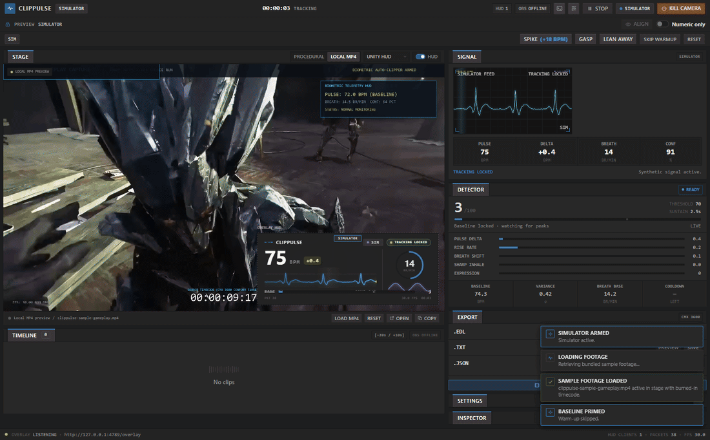
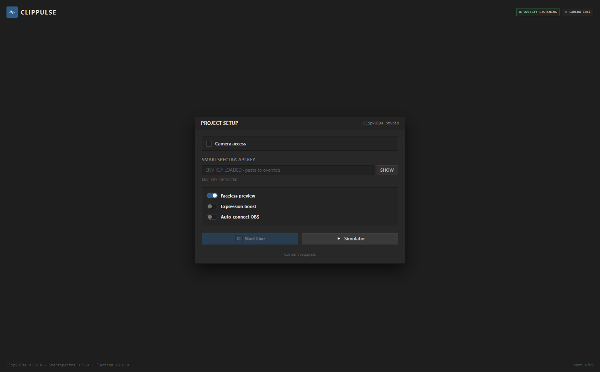
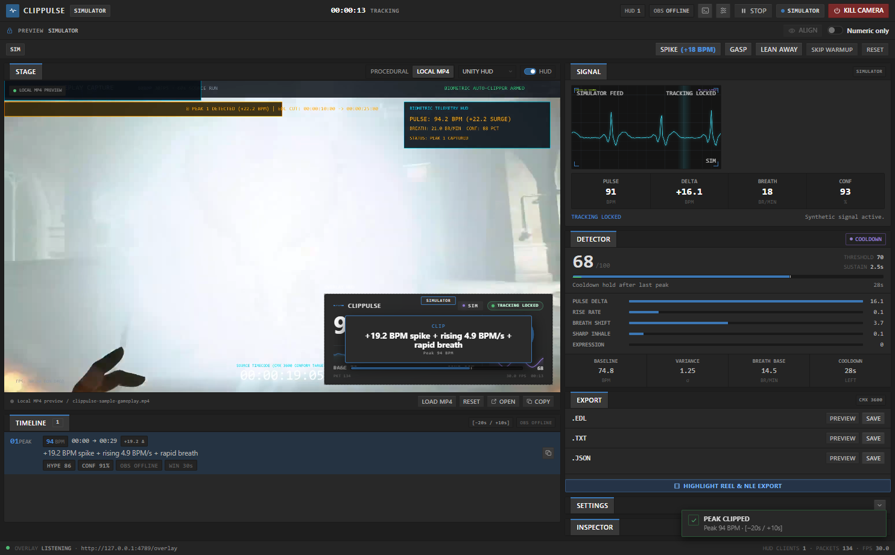
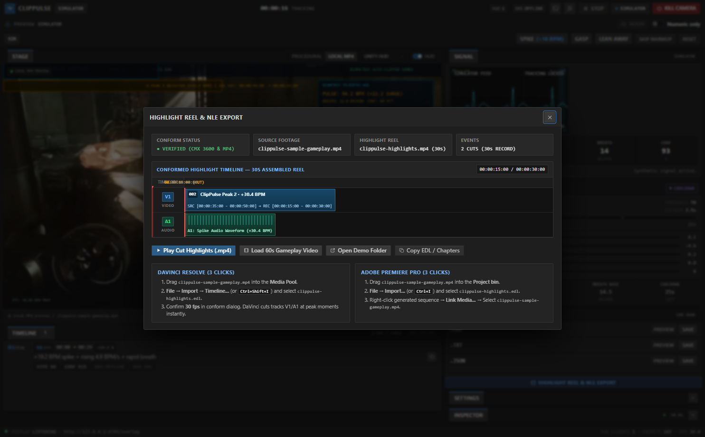

# ⚡ ClipPulse

<div align="center">

**Contactless Biometric OBS Overlay & Deterministic VOD Auto-Clipper**

*Transforming streamer pulse and breathing signals into transparent 60fps OBS HUDs and automated highlight reels — zero wearables, zero facecam exposure, zero video persistence.*

[](LICENSE)
[](https://nodejs.org/)
[](https://www.electronjs.org/)
[](test/)
[](https://obsproject.com/)
[](https://physiology.presagetech.com/)
[](#privacy-and-data-handling)

</div>

---



<p align="center">
  
  
  
</p>

---

## Table of Contents

- [Overview](#overview)
- [Key Features](#key-features)
- [System Architecture](#system-architecture)
- [Highlight Reel & NLE Conformance](#highlight-reel--nle-video-editing-conformance)
- [Prerequisites](#prerequisites)
- [Quick Start](#quick-start--three-steps)
- [OBS Studio Integration](#obs-studio-integration)
  - [OBS Browser Source HUD](#obs-browser-source-hud)
  - [OBS WebSocket v5 Actions](#obs-websocket-v5-actions)
- [Operating Modes](#operating-modes)
  - [LIVE Mode](#live-mode)
  - [SIMULATOR Mode](#simulator-mode)
- [Deterministic Peak Detector](#deterministic-peak-detector)
- [Export Formats](#export-formats)
- [Privacy & Security Guarantees](#privacy-and-data-handling)
- [Verification & Automated Tests](#verification)
- [Repository Structure](#project-layout)
- [Troubleshooting](#troubleshooting)
- [Disclaimer & License](#license)

---

## Overview

**ClipPulse** is a local-first Electron studio that converts contactless pulse and breathing signals into a hardware-accelerated OBS overlay and a deterministic highlight list. Powered by the **Presage SmartSpectra SDK** in LIVE mode, ClipPulse measures physiological signals through standard optical camera reflections using remote photoplethysmography (rPPG).

It eliminates the friction of physical chest straps, preserves creator privacy with a built-in faceless silhouette blur, and automates post-broadcast editing by producing industry-standard CMX 3600 Edit Decision Lists (`.edl`) conformed to the creator's peak emotional moments.

ClipPulse also includes a zero-hardware **SIMULATOR mode**, enabling developers and evaluators to exercise the entire signal scoring pipeline, OBS integration, and timeline exports without a physical webcam or API key.

---

## Key Features

- 🫀 **Contactless Biometric Capture**: Tracks pulse rate, pulse delta, and breathing cadence directly from optical camera reflections. No chest straps, smartwatches, or wearable battery interruptions.
- 📺 **Transparent 60fps OBS HUD**: Serves a dynamic, hardware-accelerated glass HUD at `http://127.0.0.1:4789/overlay` with real-time waveform rendering, breathing cadence rings, confidence pills, and animated **AUTO-CLIPPED** toast alerts.
- 🎯 **Deterministic Peak Detector**: Pure mathematical signal pipeline with a 120-second rolling baseline, dynamic outlier rejection (`max(6 BPM, 2.5σ)`), continuous 2.5-second sustain verification, and a 30-second cooldown gate to eliminate false triggers.
- 🎬 **Universal NLE Conformance**: Generates frame-accurate CMX 3600 EDLs that import directly into **DaVinci Resolve** and **Adobe Premiere Pro**, cutting clips end-to-end on the record timeline with zero human intervention.
- 📡 **Native OBS WebSocket v5 Control**: Automatically commands OBS Studio to execute `SaveReplayBuffer` and `CreateRecordChapter` the exact moment a peak trigger occurs.
- 🛡️ **Privacy by Design**: Faceless preview enabled by default (42 px silhouette blur) with a 5-second unblur alignment hold. Video frames never leave the renderer process, metric buffers live only in volatile RAM, and an instant hardware **KILL CAMERA** killswitch is accessible at all times.
- 🕹️ **Interactive SIMULATOR Mode**: Includes a 10 Hz synthetic signal generator with interactive adrenaline triggers (*Boss-Fight Spike +18 BPM*, *Gasp / Sharp Inhale*, *Lean Away / Tracking Lost*, and *Skip Warmup*) for instant verification.

---

## System Architecture

```text
┌───────────────────────────────── Electron Main Process ─────────────────────────────────┐
│  src/main.js                                                                            │
│   • Camera Permission Interception (file:// only, explicit consent gate)                 │
│   • Pure Deterministic HypeDetector (120s baseline, hysteresis, cooldown)              │
│   • Loopback Static HTTP + WebSocket Server (127.0.0.1:4789)                            │
│   • OBS WebSocket v5 Client (SaveReplayBuffer + CreateRecordChapter)                    │
│   • Multi-Format Exporter (CMX 3600 EDL, YouTube Chapters, Session JSON)                │
└───────────────────────────────▲───────────────────────────────┬─────────────────────────┘
                                │ Numeric Telemetry (IPC)       │ State & Clips (IPC)
                                │                               │
┌───────────────────────────────┴───────────────────────────────▼─────────────────────────┐
│  Studio Control Room (src/renderer)                                                     │
│   • Unity Editor Dark Interface (charcoal #1e1e1e palette, docked panels)               │
│   • Presage SmartSpectra SDK v3.5.0 (renderer MediaStream capture)                     │
│   • Faceless Privacy Preview (blur(42px)) + 5s Alignment Hold                           │
│   • Standalone 16:9 OBS Preview Stage (procedural canvas or local .mp4)                 │
│   • In-App Highlight Reel & NLE Conformance Modal with Stage Playback                   │
└───────────────────────────────────────────────────────────────┬─────────────────────────┘
                                                                │ WebSocket ws://127.0.0.1:4789/ws
┌───────────────────────────────────────────────────────────────▼─────────────────────────┐
│  OBS Browser Source (src/overlay)                                                       │
│   • Transparent 500×200 Glass HUD with 60fps RAF Canvas Waveform                        │
│   • Dynamic Themes (Cyber, Minimal, Compact) + AUTO-CLIPPED Toast Notification          │
└─────────────────────────────────────────────────────────────────────────────────────────┘
```

---

## Highlight Reel & NLE Video Editing Conformance

ClipPulse's deterministic clipping pipeline outputs standard CMX 3600 Edit Decision Lists (`.edl`) that conform directly in professional video editors like DaVinci Resolve and Adobe Premiere Pro, as well as an assembled highlight reel (`.mp4`) playable in VLC or any media player.

### Local Reference Asset Generator

To verify external NLE conformance without bloating the repository with heavy binary footage, ClipPulse includes a one-command asset generation suite:

```powershell
npm run generate:demo
```

This compiles a full conformance package in `demo-assets/`:
- `clippulse-sample-gameplay.mp4`: 60-second 1080p 30fps action gameplay capture with frame-accurate burned-in source timecode (`00:00:00:00` to `00:00:59:29`) and synchronized audio.
- `clippulse-highlights.mp4`: 30-second conformed highlight video reel cut and assembled at the exact peak moments.
- `clippulse-highlights.edl`: Standard CMX 3600 EDL defining cuts for Peak 1 (`00:00:10:00` - `00:00:25:00`) and Peak 2 (`00:00:35:00` - `00:00:50:00`).
- `clippulse-chapters.txt`: YouTube / Twitch formatted chapter marks starting at `00:00`.
- `clippulse-session.json`: Complete telemetry log conforming to `clippulse.session.v1`.

### In-App Verification Modal

Open the **Export** panel in ClipPulse Studio and click **HIGHLIGHT REEL & NLE EXPORT**:
1. Click **Play Cut Highlights (.mp4)** to watch the conformed highlight reel directly inside the Stage.
2. Click **Load 60s Gameplay Video** to inspect the source capture with burned-in timecode.
3. Review the multi-track conformed timeline display showing tracks V1 and A1 with exact timecodes and delta BPM.
4. Click **Copy EDL / Chapters** for instant clipboard access.

### 3-Click NLE Import Instructions

#### DaVinci Resolve
1. Drag `clippulse-sample-gameplay.mp4` into the **Media Pool**.
2. Select **File → Import → Timeline...** (or press `Ctrl+Shift+I` / `Cmd+Shift+I`) and choose `clippulse-highlights.edl`.
3. Confirm **30 fps** in the conform dialog. DaVinci cuts tracks V1 and A1 at the exact peak moments instantly.

#### Adobe Premiere Pro
1. Drag `clippulse-sample-gameplay.mp4` into the **Project** bin.
2. Select **File → Import...** (or press `Ctrl+I` / `Cmd+I`) and select `clippulse-highlights.edl`.
3. Right-click the imported sequence → **Link Media...** → select `clippulse-sample-gameplay.mp4`.

---

## Prerequisites

- **Operating System**: Windows 11 / 10 is the primary development and testing target. macOS and Linux are supported where the SmartSpectra SDK provides native binaries.
- **Node.js**: Node 20.0.0 or newer (Node 24 LTS recommended).
- **Webcam**: Standard USB or integrated webcam (required for LIVE mode).
- **Presage SmartSpectra API Key**: Required for LIVE mode. Obtain a key at [physiology.presagetech.com](https://physiology.presagetech.com/auth/login).
- **OBS Studio**: OBS Studio 30+ with OBS WebSocket 5.x (optional; highlight clipping and file exports function independently of OBS).

---

## Quick Start — Three Steps

### 1. Install Dependencies

```powershell
npm install
```

### 2. Configure Environment

Create your `.env` configuration from the provided template:

```powershell
Copy-Item .env.example .env
notepad .env
```

```bash
# macOS / Linux
cp .env.example .env
nano .env
```

Set your API key:
```env
SMARTSPECTRA_API_KEY=your_actual_key_here
```

*(Note: You can also paste an API key directly into the launch screen setup modal at runtime; it is stored solely in volatile main-process memory for the duration of the session).*

### 3. Build & Launch

```powershell
npm start
```

Choose **Start live session** after granting camera consent, or click **Simulator** to exercise the signal detector, transparent overlay, interactive stage, and timeline exports without camera hardware.

To launch with DevTools attached:
```powershell
npm run dev
```

### Windows Terminal Note: `ELECTRON_RUN_AS_NODE`

Some developer terminals and IDE shells export `ELECTRON_RUN_AS_NODE=1`. When active, Electron launches as a headless Node process without opening a desktop window. ClipPulse's launcher (`npm start`) automatically detects and unsets this variable.

If launching Electron directly:
```powershell
Remove-Item Env:ELECTRON_RUN_AS_NODE -ErrorAction SilentlyContinue
npx electron .
```

---

## OBS Studio Integration

### OBS Browser Source HUD

1. In OBS Studio, add a new **Browser** source under your scene.
2. Set the URL to:
   ```text
   http://127.0.0.1:4789/overlay
   ```
3. Set **Width** to `500` and **Height** to `200`.
4. Leave custom CSS empty and keep the background transparent. ClipPulse renders a hardware-accelerated, transparent glass background natively.
5. Select an optional theme via URL query parameter:
   - `?theme=cyber` (default neon telemetry styling)
   - `?theme=minimal` (monochrome wireframe)
   - `?theme=compact` (dense HUD for tournament streams)

The overlay automatically reconnects if ClipPulse restarts. When the WebSocket connection drops, a subtle **LINK LOST** pill appears and the HUD dims smoothly.

### OBS WebSocket v5 Actions

1. In OBS Studio, navigate to **Tools → WebSocket Server Settings**.
2. Enable the WebSocket server (default port is `4455`).
3. Set a server password, then add it to your `.env` as `OBS_WS_PASSWORD=...` or paste it into ClipPulse's **OBS LINK** settings panel.
4. To enable automated replay-buffer clips, turn on **Replay Buffer** under OBS **Settings → Output**. ClipPulse issues `SaveReplayBuffer` commands; it does not record video itself.
5. Chapter markers are written via `CreateRecordChapter` whenever OBS Studio is actively recording.

If OBS is offline, ClipPulse continues detecting peaks locally, records clips to the timeline, and displays `OBS OFFLINE` without interrupting the broadcast.

---

## Operating Modes

### LIVE Mode

- The renderer process owns the camera stream via the `@smartspectra/node-sdk` renderer engine.
- Video frames never leave renderer memory and are never written to disk or sent over IPC.
- LIVE mode registers exactly one listener per SDK event, sets `enableTelemetry: false`, preserves monotonic per-stream timestamps, and avoids attaching any `videoOutput` listeners.
- Launching LIVE mode strictly requires ticking the consent gate and supplying an API key.

### SIMULATOR Mode

SIMULATOR mode is clearly badged **SIMULATOR MODE — NO LIVE CAMERA** across the header, signal inspector, stage, and OBS overlay. It generates a 10 Hz synthetic physiological signal and provides four real-time demo triggers:

- **Boss-Fight Spike (+18 BPM)**: Generates a steep pulse surge with accelerated breathing.
- **Gasp / Sharp Inhale**: Triggers a rapid breath cadence irregularity.
- **Lean Away / Validation Lost**: Simulates lost optical tracking and graceful recovery.
- **Skip Warm-up**: Instantly primes the 120-second rolling baseline to test triggers immediately.

---

## Deterministic Peak Detector

The detector is pure, deterministic, and driven by sample timestamps rather than wall-clock time:

- **Rolling Baseline**: 120-second rolling window of valid, high-confidence samples. Readings exceeding `max(6 BPM, 2.5σ)` are rejected as outliers to prevent temporary adrenaline spikes from drifting the baseline.
- **Composite Score (0–100 Points)**:
  - **Pulse Delta**: up to `62 pts`
  - **Rate-of-Rise Slope**: up to `18 pts`
  - **Breathing Cadence Deviation**: up to `12 pts`
  - **Sharp Inhale Irregularity**: up to `8 pts`
  - **Expression Boost** (optional): up to `12 pts`
- **Hysteresis & Sustain Gate**: Composite score must remain at or above threshold (default `70`) continuously for **2.5 seconds**.
- **Cooldown Interval**: A **30-second cooldown** enforces spacing between clips.
- **Confidence Gate**: Requires sample confidence $\ge 0.4$ and validation state `TRACKING LOCKED`.
- **Clip Window**: Emits frame range `[trigger − 20s, trigger + 10s]` (30-second total clip duration).
- **Runtime Tuning**: Threshold (40–95), sustain (1–6 s), and cooldown (10–120 s) are dynamically adjustable from the Settings drawer.

---

## Export Formats

- **CMX 3600 EDL (`.edl`)**: Standard Edit Decision List formatted at 30 fps (configurable). Clips are laid end-to-end on a clean record timeline for instant conforming in DaVinci Resolve and Adobe Premiere Pro.
- **Platform Chapters (`.txt`)**: YouTube and Twitch compatible chapter marks formatted as `MM:SS` or `HH:MM:SS`, always anchored at `00:00`.
- **Session Telemetry (`.json`)**: Structured telemetry export adhering to schema `clippulse.session.v1`, containing session configuration, clip timecodes, peak metrics, and summary statistics.

All exports are synthesized in the main process and saved through native OS file dialogs.

---

## Privacy and Data Handling

- **Explicit Consent Gate**: Optical camera access is blocked until the creator explicitly checks the consent gate checkbox.
- **Always-Visible Camera Status & Killswitch**: The header displays `CAMERA LIVE` or `CAMERA IDLE`. The **KILL CAMERA** button is available in every state, immediately revoking camera permissions, cutting media tracks, zeroing telemetry buffers, and purging active clip lists.
- **Faceless Silhouette Preview**: A 42 px Gaussian blur silhouette is enabled by default. Creators can press and hold **Alignment Check (Unblur)** for 5 seconds to verify framing before blur re-engages automatically.
- **Zero Video Persistence**: Raw camera frames remain in volatile memory and are discarded immediately after processing. Video frames are never written to disk, never logged, and never transmitted across IPC or network sockets.
- **Loopback-Only Binding**: The HTTP and WebSocket server binds strictly to `127.0.0.1`. It is inaccessible from the local area network.
- **Secure Key Management**: API keys are loaded via `.env` or input at launch. They are never written to disk logs, never forwarded to the OBS overlay, and `.env` is permanently gitignored.
- **Stage Isolation**: Dropping a local `.mp4` into the stage loads it as a local `blob:` URL in the renderer only. It is never uploaded or modified.

---

## Verification

ClipPulse includes a comprehensive automated test and verification suite:

```powershell
npm test          # 54 automated unit and integration tests across 6 suites
npm run build     # esbuild renderer bundle
npm run check:vocab # prohibited-term vocabulary guard
npm run verify:nle # automated headless Electron test for NLE dialog and demo assets
```

### Prohibited Vocabulary Guard

To ensure strict compliance with creator tool vocabulary standards, `scripts/check-vocabulary.js` scans all source code, tests, documentation, and metadata files. The vocabulary guard ensures that non-clinical, signal-accurate terminology is preserved across all user-facing interfaces.

---

## Project Layout

```text
ClipPulse/
├── .env.example                 # Environment template for SmartSpectra & OBS
├── .gitignore                    # Git exclusions (credentials, node_modules, demo-assets)
├── LICENSE                       # MIT License
├── package.json                  # Dependencies, build targets, and scripts
├── clippulse-demo.gif            # Studio control room animated walkthrough
├── gate-preview.png              # Consent gate and project launch setup
├── studio-preview.png            # Studio control room workspace and telemetry
├── export-dialog-preview.png     # NLE conformance modal and multi-track display
├── src/
│   ├── main.js                   # Electron main process, IPC routing, hype detector
│   ├── preload.js                # Context-isolated bridge and SmartSpectra bindings
│   ├── renderer/
│   │   ├── index.html            # Studio workspace layout, stage, and modal dialogs
│   │   ├── styles.css            # Dark broadcast-studio UI stylesheet
│   │   └── app.js                # Renderer controller (camera, stage, UI state)
│   ├── engine/
│   │   ├── signal-provider.js    # SmartSpectra capture driver & SIMULATOR generator
│   │   ├── hype-detector.js      # Pure baseline model, composite score, hysteresis
│   │   ├── exporter.js           # Pure CMX 3600 EDL, chapters, and JSON formatters
│   │   └── obs-client.js         # OBS WebSocket v5 integration client
│   ├── server/
│   │   └── overlay-server.js     # Loopback HTTP and WebSocket server (port 4789)
│   ├── overlay/
│   │   ├── overlay.html          # Transparent 500x200 OBS browser HUD
│   │   ├── overlay.css           # Glass HUD visual styles and themes
│   │   └── overlay.js            # 60fps RAF canvas waveform & toast controller
│   └── shared/
│       └── validation.js         # Signal validation codes and UI labels
├── scripts/
│   ├── start.js                  # Electron bootstrapper (unsets ELECTRON_RUN_AS_NODE)
│   ├── build.js                  # esbuild renderer bundling script
│   ├── check-vocabulary.js       # Vocabulary compliance verification guard
│   ├── generate-demo-assets.js   # Local demo footage, timecode burn-in & EDL generator
│   ├── render-highlights.js      # FFmpeg conformance cutter for highlight reel
│   └── verify-nle.js             # Headless Electron verification of NLE modal
└── test/
    ├── exporter.test.js          # Tests for EDL, TXT, and JSON builders
    ├── hype-detector.test.js     # Baseline, outlier rejection, score & hysteresis tests
    ├── obs-client.test.js        # OBS WebSocket event and command mocking tests
    ├── overlay-server.test.js    # HTTP and WebSocket loopback route tests
    ├── signal-provider.test.js   # SIMULATOR signal generator and metric decoders
    └── validation.test.js        # Validation code mapping and gating tests
```

---

## Troubleshooting

### Overlay is blank in OBS
- Open `http://127.0.0.1:4789/status` in your browser.
- If it does not respond, port `4789` may be occupied by another application. Restart ClipPulse and refresh the OBS Browser source.

### OBS stays offline
- Ensure **WebSocket Server** is enabled in OBS under **Tools → WebSocket Server Settings**.
- Verify the port (default `4455`) and password match your `.env` or in-app settings.
- ClipPulse continues clipping locally even when OBS is offline.

### Camera will not start
- Ensure no other application (Discord, Zoom, OBS Virtual Camera) is holding an exclusive camera lock.
- Verify camera permissions are enabled in Windows Settings (**Privacy & security → Camera**).
- Confirm the consent checkbox is checked in the launch dialog.
- Switch to **Simulator** to test the entire pipeline without a camera.

### LIVE start button remains disabled
- Verify that `SMARTSPECTRA_API_KEY` is populated in `.env` or entered directly into the setup field.
- Ensure the **Camera access** consent box is checked.

### Window does not appear on launch
- Some terminal environments set `ELECTRON_RUN_AS_NODE=1`. Running `npm start` automatically clears this flag.

---

## License

This project is licensed under the [MIT License](LICENSE).

### Disclaimer

*ClipPulse is a creator companion tool designed for streaming and content creation, not a clinical instrument. It makes no claims about wellness, fitness, or any medical condition.*
